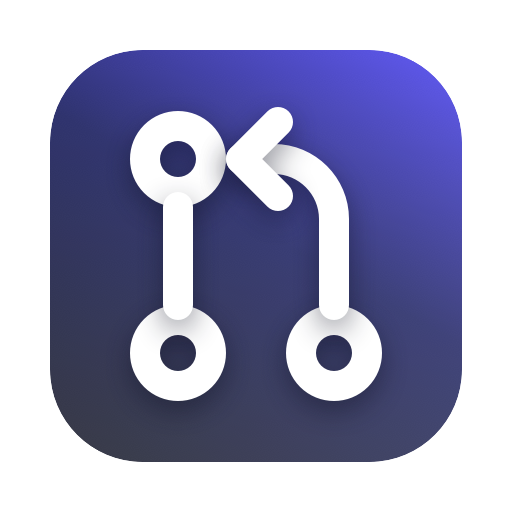

# PR Watch

A small macOS app and desktop widget that lists a GitHub repository's open pull requests the way
GitHub's own list shows them: the pull-request icon, the title in bold, the label pills in their
own colours, "#371 · octocat opened 18 hours ago" underneath and the comment count on the
right. Each widget on the desktop watches one repository, refreshes about every hour, and has a
"Last synced at …" line with a ↻ that refreshes it at once. Clicking a pull request opens it in
your browser.



- **Widget** (Medium, Large, Extra Large): as many rows as fit the widget's height (about 3 in
  Medium, 7 in Large, 14 in Extra Large, which uses two columns); the rest is a "+N more" link
  in the footer. Drafts have a grey icon and "· Draft" on the second line; a
  switch in the widget's configuration leaves them out. The header (repository name, "Open N")
  opens the repository's pull requests page.
- **App** (SwiftUI, macOS 14 or later): one window to sign in (paste a token, or borrow the
  `gh` CLI's), the repositories the widgets have cached with their last sync time and PR count,
  and "Refresh all widgets". Closing the window quits the app.
- **Script**: `Scripts/refresh-widgets.sh` refreshes every widget from the shell, so a git hook
  or an AI coding agent can update the desktop the moment a pull request is opened or merged.

It is signed with your own Apple Developer team (a free personal team is enough) and runs from
Xcode; it is not distributed through the App Store.

## Install

1. Install Xcode (from the App Store) and, ideally, [XcodeGen](https://github.com/yonaskolb/XcodeGen):
   `brew install xcodegen`. Without it the script below patches the checked-in project instead.
2. Clone the repository and point the project at your team:

   ```bash
   git clone https://github.com/Jashvant27/pr-watch.git
   cd pr-watch
   Scripts/set-team.sh <TEAM_ID> com.yourname
   ```

   `TEAM_ID` is the 10-character id of your team: Xcode → Settings → Accounts → your Apple ID →
   the team's "Team ID"; a free personal team is enough. The bundle prefix only has to be unique
   on your Mac. The script rewrites the team id and the two group ids everywhere (see "Things to
   know" for why they must stay in step) and regenerates the Xcode project.
3. Open `PRWatch.xcodeproj`, select the `PRWatch` scheme and My Mac, and press Run. Xcode signs
   both targets with your team. The window opens: sign in (below).
4. Add a widget: click the desktop (or the clock in the menu bar), Edit Widgets, search
   "PR Watch", drag out a size. Right-click the widget → Edit Widget, paste the repository and
   press Done. Repeat for every repository you want on the desktop.

To check that everything compiles without signing:

```bash
DEVELOPER_DIR=/Applications/Xcode.app/Contents/Developer xcodebuild -project PRWatch.xcodeproj -scheme PRWatch -configuration Debug CODE_SIGNING_ALLOWED=NO build
```

## Signing in to GitHub

The widget calls `api.github.com` itself, with a token it reads from your keychain. The app puts
it there, from one of two sources:

- **Paste a token**: a classic personal access token with the `repo` scope, or a fine-grained
  token with read access to *Pull requests* (and *Metadata*) on the repositories you watch. For an
  organisation's private repositories a fine-grained token must have that organisation as its
  resource owner, and the organisation must allow fine-grained tokens. The app checks the token
  with `GET /user` and shows the login it belongs to.
- **Use gh CLI token**: runs `gh auth token` (the app is not sandboxed, so it can) and stores
  that token the same way, marked as coming from gh. The `gh` login's token already reads the
  private repositories you can see, so this is the quick way. If you later `gh auth logout` or
  refresh gh's token, the stored copy stops working: press the button again.

The token is one generic-password item in the data-protection keychain, in the keychain access
group `<TEAM_ID>.<prefix>.prwatch` that both the app and the widget carry in their entitlements.
It never leaves your Mac except to `api.github.com`. The app never shows it again; "Sign out"
deletes it. The login and the token's source are kept in `account.json` next to the cache (not
secret).

## Repositories

The Repository field of a widget takes `owner/name` or anything that contains it:
`https://github.com/owner/name`, `github.com/owner/name/pulls`, `git@github.com:owner/name.git`.
A trailing `.git`, `/` or anything after the name is dropped. Each widget is independent: three
widgets can watch three repositories.

The app cannot ask macOS which widgets are on the desktop (WidgetKit does not expose it), so its
"Recent repositories" list is built from the cache files: every repository a widget has fetched,
with its PR count, last sync time and last problem. Open it on GitHub, fetch it now (↻), or
"Forget" it (deletes the cache file; a widget that still watches it recreates it on its next
refresh).

## Refresh and rate limits

- Every widget asks WidgetKit to come back in an hour; macOS may stretch that when the Mac is
  busy or asleep. The ↻ in the footer fetches at once (the footer dims while it runs) and then
  reloads the widget. "Refresh all widgets" in the app (Cmd+R) fetches every cached repository
  and then reloads every widget; so does `Scripts/refresh-widgets.sh`.
- One refresh costs 1 request for the list plus 1 per pull request for its comment count
  (`comments + review_comments` from the single-PR endpoint; the list endpoint has no counts),
  for at most the first 30 pull requests. An authenticated token has 5000 requests per hour, so
  a widget on a repository with 30 open PRs uses under 1 % of that per hour. GitHub's own list
  also counts review summaries, so its number can be one or two higher than the widget's.
- `401` shows "Not authorised: open PR Watch to sign in"; `404` "Repository not found (or the
  token cannot see it)", which is also what GitHub answers for a private repository the token
  cannot read; `403` with the limit exhausted (or `429`) "Rate limited until HH:mm" from the
  `x-ratelimit-reset` header. The last good list stays on the widget with the problem in orange
  in the footer; without any good list the problem is shown in the middle.
- The widget shows at most 100 open pull requests ("100+" in the header beyond that).
- The client never uses the URL cache: GitHub answers with `Cache-Control: max-age=60`, and a
  cached answer would make a ↻ pressed within a minute of the last fetch report "synced" with the
  old list (a merged PR stayed on the widget that way).

## Data

Everything lives in the App Group container,
`~/Library/Group Containers/<TEAM_ID>.<prefix>.prwatch/Library/Application Support/PRWatch/`:

- `cache/<owner>__<name>.json`: the last good list (`snapshot`) and the last attempt (`lastAttempt`,
  `lastStatus`, `lastProblem`, `rateLimitRemaining`, `rateLimitReset`), per repository. The widget
  renders it instantly and keeps it under an error. Widgets → Reveal Cache in Finder opens it.
- `account.json`: `login`, `source` ("pasted" or "gh"), `checkedAt`.
- `settings.json`: `{"debugLogging": true}`.

## Scripts

```bash
Scripts/refresh-widgets.sh                  # fetch every cached repository and reload the widgets now
Scripts/set-team.sh ABCDE12345 com.yourname # once, after cloning
swift Scripts/make_icon.swift PRWatch/Assets.xcassets/AppIcon.appiconset Design/icon-preview.png
```

`refresh-widgets.sh` sends `prwatch://refresh` to the app (`open -g`), which fetches each
repository in its cache, reloads every widget and quits again when it was launched only for that.
Run it after opening, drafting or merging a pull request, from a terminal, a git hook or an AI
coding agent, so the widgets do not wait for their hourly refresh. The app must have run once
from Xcode, which registers the scheme. The other URL is `prwatch://open?url=<github.com page>`,
which the widget rows use.

This is what makes the widget useful next to an AI coding agent: tell it to run
`refresh-widgets.sh` whenever it opens or merges a pull request, and the desktop follows.

## Layout

- `Shared/` compiled into both targets: `Model.swift` (RepoRef parsing, PullRequest, the cache
  entry, GitHub's relative-time wording, label colours), `SharedStore.swift` (the container, the
  cache files, settings), `TokenStore.swift` (the keychain item), `GitHubClient.swift` (the two
  API calls, the error states, `RepoFetcher` which fetches one repository into its cache file).
- `PRWatch/` the app: `PRWatchApp.swift` (window, menus, Settings, the AppDelegate that opens
  widget links in the browser, handles `prwatch://refresh` and quits on close), `AppModel.swift`
  (sign-in, recents, the gh CLI), `ContentView.swift`.
- `PRWatchWidget/PRWatchWidget.swift` the widget: the configuration intent (Repository, Include
  drafts), the refresh intent, the timeline provider and the view.
- `Scripts/`: `refresh-widgets.sh` and `set-team.sh` (above); `make_icon.swift` draws the icon
  with CoreGraphics (no bitmap source) into `PRWatch/Assets.xcassets/AppIcon.appiconset` at every
  macOS size, plus `Design/icon-preview.png`.
- `project.yml` is the XcodeGen source of `PRWatch.xcodeproj`; after editing it run
  `xcodegen generate`.

## Things to know

- **Clicks go through the app.** WidgetKit hands every link in a widget to the containing app,
  so a pull request's row links to `prwatch://open?url=<its GitHub URL>`; the app opens that URL
  in the default browser and, when it was launched only for that, quits again before its window
  shows. Only `https://github.com` URLs are opened. The app has to have run once from Xcode,
  which registers the `prwatch` scheme.
- **Team-ID-prefixed ids.** The App Group and the keychain access group are both
  `<TEAM_ID>.<prefix>.prwatch`, not `group.`-prefixed: a personal team's Mac provisioning
  profile carries no App Groups capability, and macOS validates the Team-ID form from the
  signature alone. The profile does carry `keychain-access-groups: <TEAM_ID>.*`, which is what
  lets the sandboxed widget read the item the app wrote. The ids live in `project.yml`, the two
  entitlements files, `Shared/SharedStore.swift` and `Shared/TokenStore.swift`;
  `Scripts/set-team.sh` keeps them in step.
- **The shared state is files, not UserDefaults**: the preferences daemon keeps App Group suite
  writes of a locally signed app in memory only.
- **If the widget looks stale**, press its ↻, or open the app and Refresh all widgets, or
  `killall chronod`. "Not signed in" on a widget right after signing in means the widget process
  has not been relaunched yet: Refresh all widgets does that. After a new Run from Xcode the
  widgets keep the old extension until they are relaunched the same way.
- **↻ does nothing and the widget keeps an old look after a command-line build.** An incremental
  `xcodebuild` can leave the extension without its `Contents/Resources/Metadata.appintents`
  (the App Intents metadata that `Button(intent:)` and the configuration intent need); WidgetKit
  then cannot ask the widget for a new timeline and keeps the last archived render. Check with
  `ls "…/PR Watch.app/Contents/PlugIns/PRWatchWidget.appex/Contents/Resources"`; if the folder is
  missing, build once more (or `xcodebuild clean` first) and `killall chronod`.
- **Keychain prompts.** The data-protection keychain never prompts; if "Keychain: …" appears in
  the app or the widget's diagnostics, the signature lost the keychain access group (quit a running
  copy of the app before the next Run: a running process keeps its old entitlements).
- **Settings (Cmd+,)** has one switch, "Debug logging": the widget's footer then shows the cache
  path, whether the token could be read and from which source, the last HTTP status and the
  remaining rate limit, and Settings lists the same per repository.
- `xcodebuild` from the shell needs `DEVELOPER_DIR=/Applications/Xcode.app/Contents/Developer`
  when the Command Line Tools are the active developer directory.

## License

MIT, see `LICENSE`.
